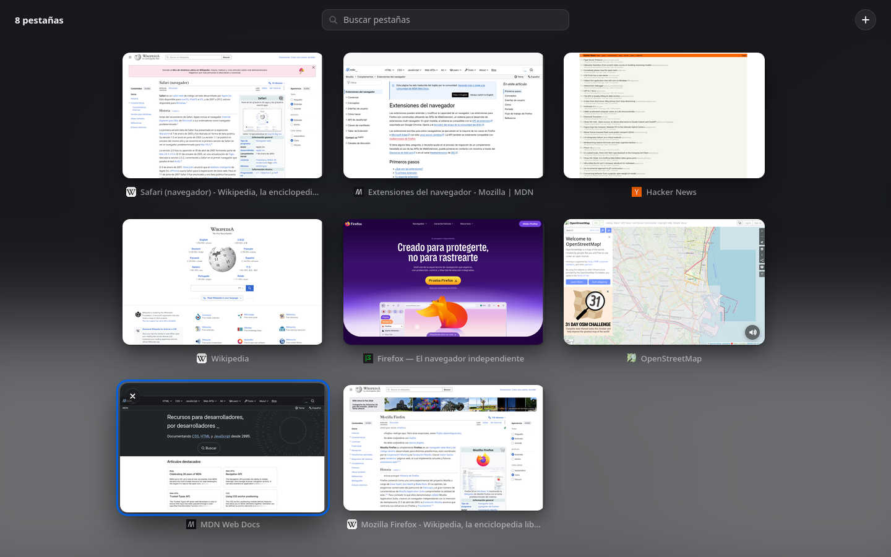
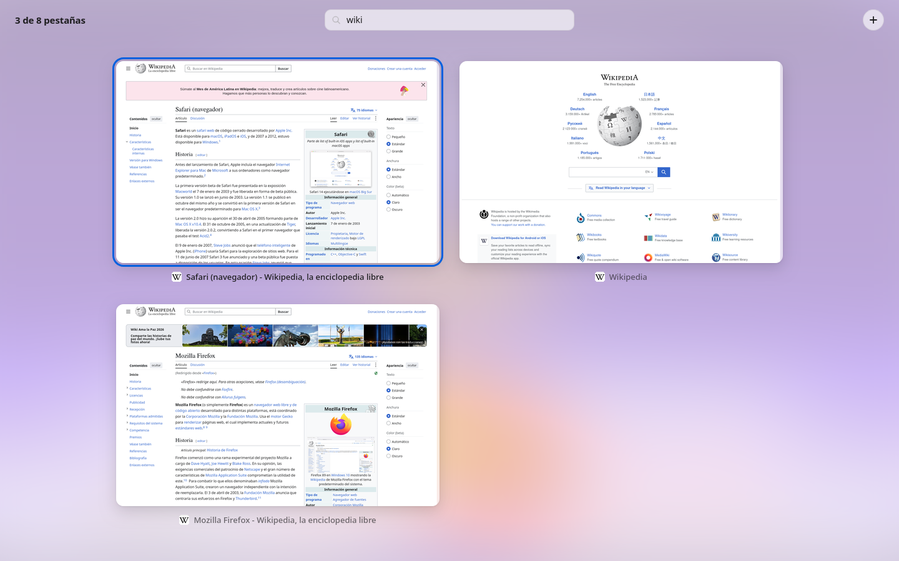

<div align="center">


# Tab Exposé

**Todas tus pestañas de un vistazo, con la vista general de Safari, ahora en Firefox.**

Pulsa un botón y la página actual se encoge hasta su sitio en una cuadrícula con todas las
pestañas de la ventana. Elige una y crece hasta llenar la pantalla. Sin saltos, con animaciones
cuidadas.

[**⬇ Descargar la última versión**](https://github.com/neldoreth/tab-expose/releases/latest/download/tab-expose.xpi)
&nbsp;·&nbsp; Firefox 140 o posterior &nbsp;·&nbsp; Firmada por Mozilla

<br>


</div>

---

## ✨ Qué hace

- **Transición continua.** La vista arranca con una captura de la página que estabas viendo, a
  pantalla completa, y la anima hasta su posición. Al elegir otra pestaña ocurre lo contrario.
  No hay un corte entre "la página" y "la vista".
- **Movimiento con física.** Las animaciones son muelles simulados, no curvas fijas. Las demás
  pestañas aparecen escalonadas alrededor de la que tenías abierta, y al cerrar o filtrar se
  recolocan con suavidad.
- **Busca escribiendo.** No hace falta pulsar en ningún sitio: escribe y la cuadrícula se filtra
  por título y dirección, sin importar tildes ni mayúsculas.
- **Teclado completo.** Flechas para moverte, `Intro` para abrir, `Esc` para volver.
- **Gestiona desde la vista.** Cierra pestañas, silencia las que suenan o abre una nueva.
- **Se adapta a ti.** Tema claro y oscuro automáticos, fondo teñido con la página actual, color de
  acento del sistema y soporte de *reducir movimiento*.

<table>
  <tr>
    <td></td>
    <td></td>
  </tr>
  <tr>
    <td align="center"><sub>Modo oscuro</sub></td>
    <td align="center"><sub>Busca escribiendo directamente</sub></td>
  </tr>
</table>

## 📦 Instalación

1. Descarga [`tab-expose.xpi`](https://github.com/neldoreth/tab-expose/releases/latest/download/tab-expose.xpi)
   desde la [última versión](https://github.com/neldoreth/tab-expose/releases/latest).
2. Ábrelo con Firefox: arrástralo a una ventana, pulsa sobre él en el panel de descargas, o ve a
   `about:addons` → ⚙ → **Instalar complemento desde archivo…**
3. Acepta los permisos. Aparecerá el botón  en la barra de herramientas.

> [!TIP]
> Si no ves el botón, búscalo en el menú de extensiones (el icono de la pieza de puzle) y fíjalo
> en la barra. Para usarla también en ventanas privadas: `about:addons` → Tab Exposé →
> **Ejecutar en ventanas privadas**.

La extensión está firmada por Mozilla, pero no está publicada en la tienda de complementos, así
que **no se actualiza sola**. Vuelve a esta página para descargar las versiones nuevas.

## ⌨️ Uso

| | |
| --- | --- |
| Abrir o cerrar la vista | Botón de la barra o <kbd>Alt</kbd>+<kbd>Shift</kbd>+<kbd>Espacio</kbd> |
| Ir a una pestaña | Clic, o <kbd>←</kbd> <kbd>↑</kbd> <kbd>→</kbd> <kbd>↓</kbd> y <kbd>Intro</kbd> |
| Volver a donde estabas | <kbd>Esc</kbd>, clic en una zona vacía o pulsar otra vez el botón |
| Buscar | Empieza a escribir. <kbd>Esc</kbd> borra la búsqueda |
| Cerrar una pestaña | Botón ✕ al pasar el ratón, clic central, o <kbd>Supr</kbd> sobre la seleccionada |
| Silenciar | Icono de altavoz en las pestañas que reproducen sonido |
| Nueva pestaña | Botón **+** arriba a la derecha |

El atajo de teclado se cambia en `about:addons` → ⚙ → **Gestionar atajos de extensiones**.

## 🔒 Privacidad y permisos

Tab Exposé **no recoge ni envía ningún dato**: no hay analíticas ni servidores, y no hace
ninguna petición a internet. Las miniaturas solo existen en la memoria del navegador y desaparecen
al cerrarlo.

| Permiso | Para qué se usa |
| --- | --- |
| Acceder a las pestañas | Leer el título, el icono y la dirección de cada pestaña, y cambiar a la elegida |
| Acceder a tus datos de todos los sitios web | Firefox lo exige para hacer capturas de pantalla de las pestañas (`tabs.captureTab`). La extensión no lee ni modifica el contenido de las páginas |

## 🛠️ Cómo funciona

Firefox no deja a una extensión dibujar sobre toda la ventana, así que la vista es una página
propia (`expose.html`) que se abre en una pestaña. El truco está en que no se note:

1. Al pulsar el botón, `background.js` captura la pestaña visible a resolución completa y abre la
   vista justo al lado.
2. La vista pinta esa captura ocupando toda la ventana, de modo que el primer fotograma es idéntico
   a lo que ya estabas viendo, y la anima (técnica FLIP) hasta su hueco en la cuadrícula.
3. Las miniaturas del resto salen de una caché que se rellena al visitar cada pestaña. Después se
   refrescan en segundo plano con `tabs.captureTab`, empezando por las que se ven en pantalla.
4. Al elegir una pestaña, su miniatura crece hasta llenar la ventana mientras se pide una captura
   nítida. Al terminar se activa la pestaña real y la vista se cierra.

Los muelles se simulan en JavaScript y se convierten a curvas `linear()` de la Web Animations API,
así que toda la animación corre en el compositor. No hay dependencias ni paso de compilación.

```
manifest.json    Manifest V2, permisos y atajo de teclado
background.js    Caché de miniaturas y apertura y cierre de la vista
expose.html      La vista general
expose.css       Estilos, temas claro y oscuro
expose.js        Disposición, animaciones, teclado, búsqueda y capturas
tools/demo/      Banco de pruebas que genera las imágenes de este README
```

### Probar cambios

1. Abre `about:debugging#/runtime/this-firefox`.
2. **Cargar complemento temporal…** → elige `manifest.json`.
3. Tras editar, pulsa **Recargar** en esa misma página.

### Limitaciones conocidas

- La vista es una pestaña, así que aparece un instante en la barra de pestañas y en la de
  direcciones.
- Las pestañas descargadas de memoria y algunas páginas internas (`about:`) no se pueden capturar.
  Se muestran con una tarjeta con su icono hasta que las visitas.
- Muestra las pestañas de la ventana actual, como Safari.

## 💡 Contribuir

Las ideas, los fallos y las mejoras son bienvenidos en
[Issues](https://github.com/neldoreth/tab-expose/issues). Si envías un *pull request*, intenta
mantener la extensión sin dependencias y las animaciones a 60 fps.

## 📄 Licencia

[MIT](LICENSE). Inspirada en la vista general de pestañas de Safari. No está afiliada a Apple ni
a Mozilla.

---

<details>
<summary><b>🇬🇧 English</b></summary>

<br>

**Tab Exposé** brings Safari's tab overview to Firefox. Click the toolbar button (or press
<kbd>Alt</kbd>+<kbd>Shift</kbd>+<kbd>Space</kbd>) and the current page smoothly shrinks into a grid
showing every tab in the window. Pick one and it zooms up to fill the screen.

- Seamless spring-physics animations (Web Animations API + `linear()` easing)
- Type to filter by title or URL; full keyboard navigation (arrows, <kbd>Enter</kbd>, <kbd>Esc</kbd>)
- Close (✕, middle-click, <kbd>Delete</kbd>), mute and open tabs from the overview
- Light and dark themes, system accent color, respects *reduced motion*
- No data collection, no network requests, no dependencies

**Install:** download [`tab-expose.xpi`](https://github.com/neldoreth/tab-expose/releases/latest/download/tab-expose.xpi)
and open it with Firefox 140+ (drag it onto a window, or use `about:addons` → ⚙ → *Install Add-on From File…*).
The add-on is signed by Mozilla but not listed on addons.mozilla.org, so it doesn't auto-update.
The UI is in Spanish.

</details>
